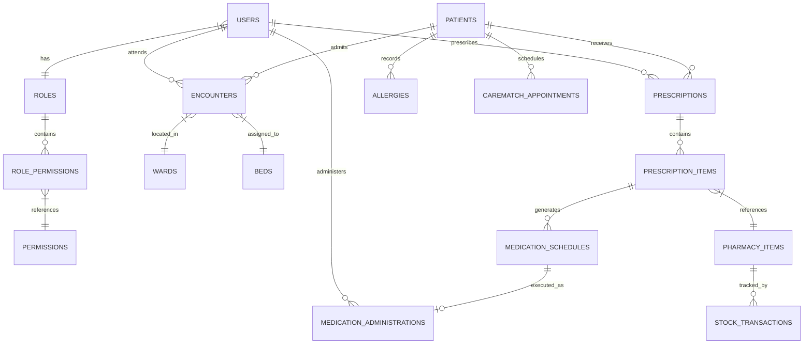

# SMARTMEDCHART — DATABASE DESIGN & DATA MODEL SPECIFICATION

**Application:** SmartMedChart  
**Database Engine:** MongoDB Atlas / MongoDB Server 7.0+  
**Architecture:** Document-Oriented NoSQL with Integer Sequences & Relational Integrity  
**Document Classification:** Database Engineering Specification  
**Last Updated:** November 11, 2026  

---

## 1. DATA MODEL ARCHITECTURE & CONVENTIONS

SmartMedChart utilizes MongoDB as its primary datastore. While MongoDB is a schema-less NoSQL engine, the application enforces rigid data contracts, strict schema validation via Pydantic v2, and referential integrity through database indexes and application-level lifecycle hooks.

### Key Database Conventions:
1. **Primary Keys (`_id`):** Primary keys are auto-incrementing integers generated atomically via the `_id_sequences` collection (`get_next_sequence_value()`). This guarantees human-readable IDs across clinical charts, prescriptions, and lab orders while eliminating MongoDB `ObjectId` serialization overhead.
2. **Timestamps:** All temporal attributes are stored in ISO 8601 UTC format (`YYYY-MM-DDTHH:MM:SS.mmmmmm`).
3. **Soft-Archival:** Clinical data (such as allergy records and discontinued prescriptions) are never destructively purged; they are soft-archived via flags (`is_active: false`, `archival_status: "ARCHIVED"`) to preserve clinical audit trails.
4. **Idempotency & Race-Condition Defense:** Atomic document updates (`find_one_and_update`, `$inc`, `$set`) and compound uniqueness constraints prevent double-booking and double-administration.

---

## 2. COLLECTION SCHEMAS & DATA DICTIONARY

### 2.1 `users` Collection
Stores authentication credentials, contact details, assigned clinical role, and account state.
- `_id` (int): Unique User ID.
- `username` (string): Unique login handle. Indexed (`uq_users_username`).
- `email` (string): Unique email address. Indexed (`uq_users_email`).
- `password_hash` (string): Cryptographic password hash (Argon2 / Bcrypt).
- `full_name` (string): Display name of clinical staff member.
- `role` (string): Role identifier (`admin`, `doctor`, `nurse`, `receptionist`, `pharmacist`).
- `role_id` (int): Integer identifier mapping to `roles._id`.
- `is_active` (bool): Account status flag. Default `true`.
- `created_at` (string): Timestamp of account creation.

### 2.2 `patients` Collection
Master Patient Index (MPI) containing patient demographics, clinical flags, and QR credentials.
- `_id` (int): Unique internal patient database sequence ID.
- `patient_id` (string): Human-readable Patient Code (e.g., `PAT-1001`). Indexed (`uq_patients_patient_id`).
- `qr_token` (string): High-entropy cryptographically generated proximity token (`secrets.token_urlsafe(32)`). Indexed partial unique (`uq_patients_qr_token`).
- `first_name` (string): Patient legal given name.
- `last_name` (string): Patient legal surname.
- `date_of_birth` (string): Date of birth (`YYYY-MM-DD`).
- `gender` (string): Gender identity (`Male`, `Female`, `Other`).
- `contact_number` (string): Phone number for contact and duplicate detection.
- `emergency_contact` (object): Next of kin name, relation, and phone.
- `allergies` (array of objects): Active allergies with `allergen`, `severity`, `reaction`, and `is_active` flag.
- `status` (string): Inpatient admission status (`ADMITTED`, `DISCHARGED`, `OUTPATIENT`).
- `current_ward_id` (int, optional): ID of currently occupied ward.
- `current_bed_id` (int, optional): ID of currently occupied bed.

### 2.3 `encounters` Collection
Represents clinical inpatient stays and admissions.
- `_id` (int): Unique Encounter ID.
- `patient_id` (int): Reference to `patients._id`.
- `doctor_id` (int): Reference to attending physician (`users._id`).
- `ward_id` (int): Reference to ward.
- `bed_id` (int): Reference to bed.
- `admission_date` (string): Timestamp of inpatient check-in.
- `discharge_date` (string, optional): Timestamp of clinical discharge.
- `status` (string): `ACTIVE` or `DISCHARGED`.

### 2.4 `prescriptions` Collection
Authoritative clinical prescription records issued by physicians.
- `_id` (int): Unique Prescription ID.
- `prescription_number` (string): Human-readable prescription code (e.g., `RX-2026-0042`).
- `patient_id` (int): Target patient ID.
- `doctor_id` (int): Authoring doctor ID.
- `encounter_id` (int, optional): Associated inpatient encounter.
- `diagnosis` (string): Clinical indication or diagnosis.
- `status` (string): `ACTIVE`, `DISPENSED`, `COMPLETED`, `DISCONTINUED`.
- `notes` (string): Clinical prescribing instructions.
- `created_at` (string): Issuance timestamp.

### 2.5 `prescription_items` Collection
Individual pharmaceutical orders linked to a prescription.
- `_id` (int): Unique Item ID.
- `prescription_id` (int): Reference to parent prescription.
- `medication_name` (string): Generic or brand pharmaceutical name.
- `dosage` (string): Prescribed dose strength (e.g., `500mg`, `10ml`).
- `route` (string): Administration route (`ORAL`, `IV`, `IM`, `TOPICAL`, `SUBLINGUAL`).
- `frequency` (string): Dose schedule frequency (`DAILY`, `BID`, `TID`, `QID`, `PRN`).
- `duration_days` (int): Number of days course is active.
- `food_relation` (string): Diet relationship (`BEFORE_FOOD`, `AFTER_FOOD`, `WITH_FOOD`).
- `status` (string): `PENDING_DISPENSE`, `DISPENSED`, `ACTIVE`, `DISCONTINUED`.

### 2.6 `medication_schedules` Collection
Specific calendar dose occurrences generated from prescription item frequency rules.
- `_id` (int): Unique Schedule ID.
- `prescription_item_id` (int): Reference to parent `prescription_items._id`.
- `patient_id` (int): Target patient ID.
- `scheduled_date` (string): Date of scheduled dose (`YYYY-MM-DD`).
- `scheduled_time` (string): Time of scheduled dose (`HH:MM`).
- `status` (string): Status of dose (`UPCOMING`, `DUE`, `GIVEN`, `HELD`, `OVERDUE`, `MISSED`).
- `dose_number` (int): Ordinal dose number in prescription course.

### 2.7 `medication_administrations` Collection
Immutable clinical audit log of physical bedside dose administrations.
- `_id` (int): Unique Administration ID.
- `medication_schedule_id` (int): Reference to target schedule. Indexed unique (`uq_med_admin_schedule_id`).
- `patient_id` (int): Administered patient.
- `nurse_id` (int): Administering nurse.
- `nurse_name` (string): Staff name for bedside record.
- `administered_at` (string): Exact physical administration timestamp.
- `status` (string): `GIVEN`, `HELD`.
- `administration_status` (string): Adherence classification calculated automatically (`ON_TIME`, `LATE`, `EARLY`).
- `notes` (string, optional): Nurse administration notes or override justification.
- `qr_verified` (bool): True if verified via bedside barcode scan.

### 2.8 `pharmacy_items` & `stock_transactions` Collections
- `pharmacy_items`: Formulary drug records with `medication_name`, `strength`, `unit`, `current_stock`, `reorder_level`.
- `stock_transactions`: Inventory ledger recording stock additions, dispensations, batch numbers, expiration dates, and dispensing user.

### 2.9 `carematch_appointments` Collection
Outpatient consultation reservations.
- `_id` (int): Unique Appointment ID.
- `doctor_id` (int): Selected specialist.
- `patient_id` (int): Patient.
- `appointment_date` (string): Date (`YYYY-MM-DD`).
- `appointment_time` (string): 30-minute time slot (`HH:MM`).
- `status` (string): `SCHEDULED`, `COMPLETED`, `CANCELLED`.
- Compound unique index: `unique_doctor_appointment_slot` on (`doctor_id`, `appointment_date`, `appointment_time`).

### 2.10 `revoked_tokens` & `login_rate_limits` (Security & TTL Collections)
- `revoked_tokens`: Stores revoked JWT `jti` identifiers with `expires_at` timestamp. Document auto-evicted via TTL index `ttl_revoked_tokens_expires_at` (`expireAfterSeconds=0`).
- `login_rate_limits`: Stores failed/sliding login counts per IP/username with `updated_at`. Document auto-evicted via TTL index `ttl_login_rate_limits_updated_at` (`expireAfterSeconds=600`).

---

## 3. INDEX SPECIFICATION & OPTIMIZATION MATRIX

| Collection | Index Name | Key Definition | Unique | TTL | Purpose |
|---|---|---|:---:|:---:|---|
| `users` | `uq_users_username` | `{"username": 1}` | **YES** | No | Prevents duplicate usernames |
| `users` | `uq_users_email` | `{"email": 1}` | **YES** | No | Prevents duplicate email addresses |
| `patients` | `uq_patients_patient_id` | `{"patient_id": 1}` | **YES** | No | Enforces unique Patient Codes |
| `patients` | `uq_patients_qr_token` | `{"qr_token": 1}` | **YES** (partial) | No | Fast lookups for bedside BCMA scans |
| `medication_administrations` | `uq_med_admin_schedule_id` | `{"medication_schedule_id": 1}` | **YES** | No | Prevents double-administration race conditions |
| `carematch_appointments` | `unique_doctor_appointment_slot` | `{"doctor_id": 1, "appointment_date": 1, "appointment_time": 1}` | **YES** | No | Prevents doctor appointment double-booking |
| `revoked_tokens` | `ttl_revoked_tokens_expires_at` | `{"expires_at": 1}` | No | **0s** | Auto-purges expired revoked JWTs |
| `login_rate_limits` | `ttl_login_rate_limits_updated_at` | `{"updated_at": 1}` | No | **600s** | Auto-purges stale rate limit counters |
| `medication_schedules` | `idx_schedules_patient_status` | `{"patient_id": 1, "status": 1, "scheduled_date": 1}` | No | No | Optimizes nurse schedule queries |
| `encounters` | `idx_encounters_patient_status` | `{"patient_id": 1, "status": 1}` | No | No | Fast resolution of active admissions |
