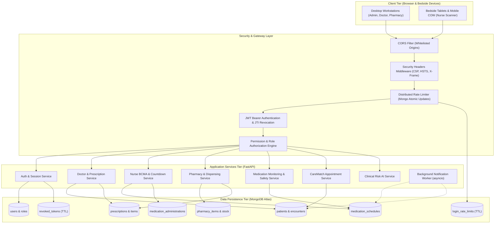
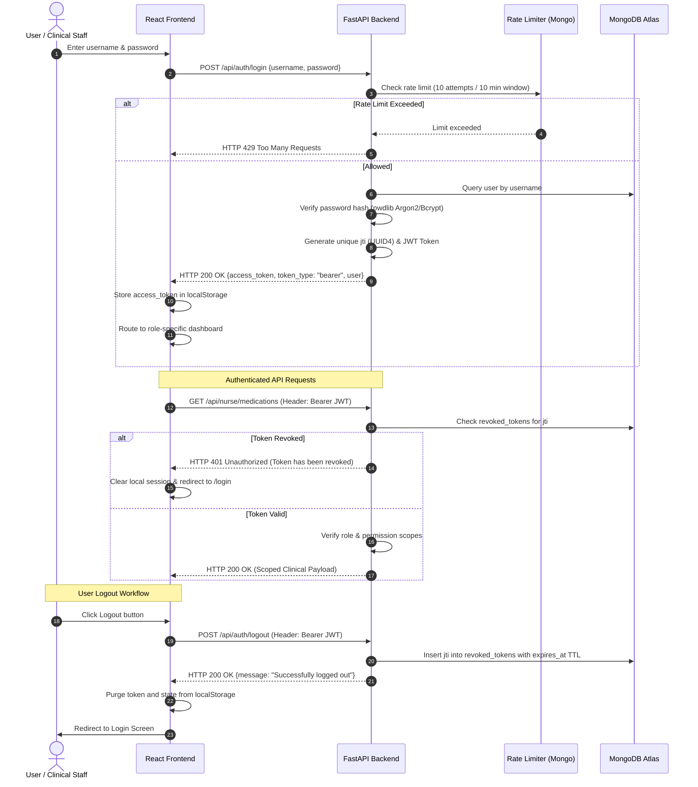
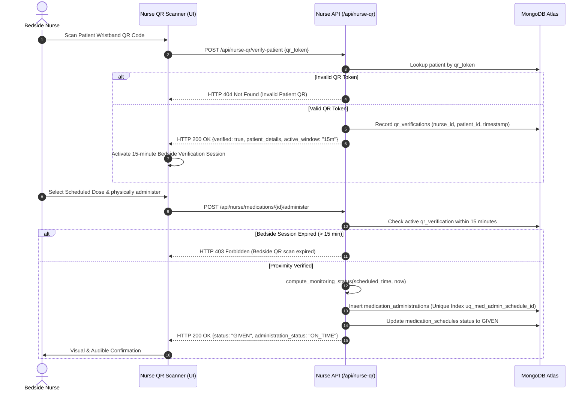
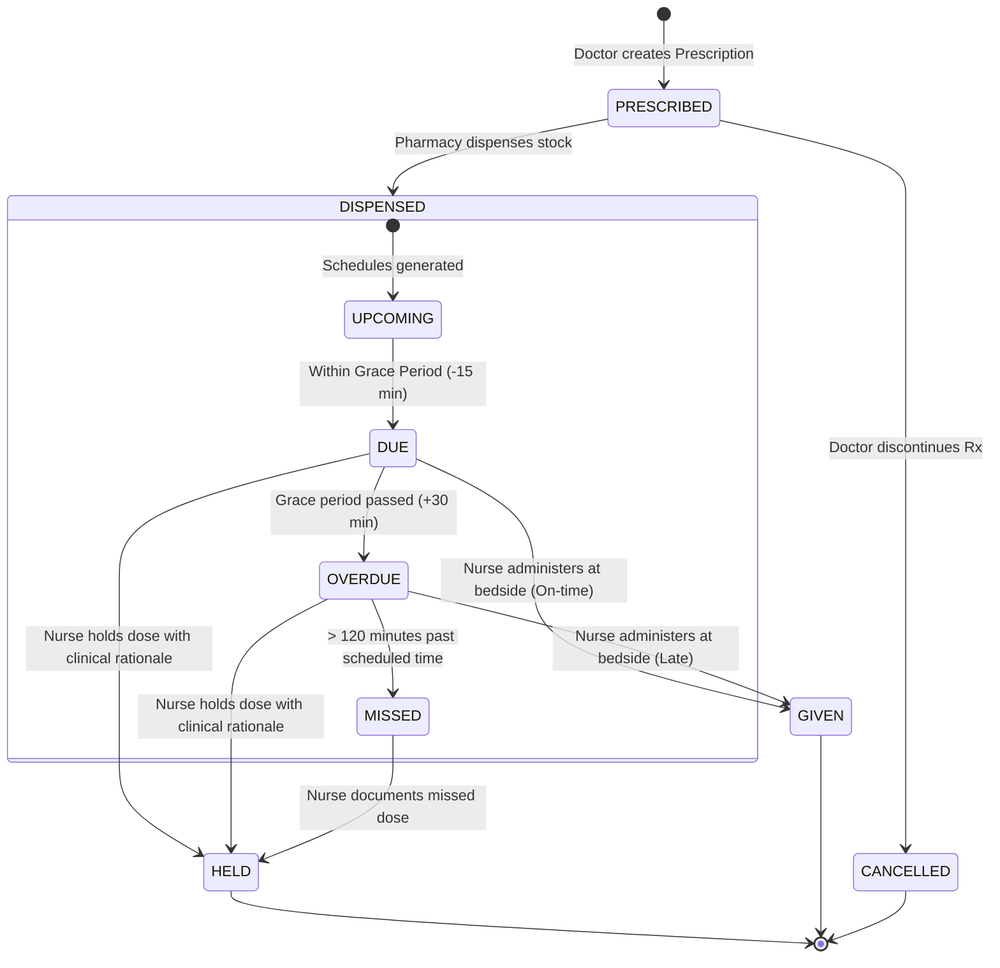

# SMARTMEDCHART — SYSTEM ARCHITECTURE SPECIFICATION

**Application:** SmartMedChart (Inpatient Clinical & Medication Administration System)  
**Version:** 1.0.0 (Production Candidate)  
**Document Classification:** Architectural Specification & Engineering Reference  
**Last Updated:** November 11, 2026  

---

## 1. ARCHITECTURAL OVERVIEW & PRINCIPLES

SmartMedChart is an enterprise electronic medical chart and Barcode Medication Administration (BCMA) platform built to prevent medication errors, streamline clinical workflows across multi-disciplinary hospital staff, and protect patient Protected Health Information (PHI).

The system follows a decoupled three-tier architecture:
1. **Presentation Tier (Frontend):** Modern Single Page Application (SPA) developed with React 18, Vite, and Tailwind CSS. It communicates asynchronously with the API gateway via Axios with automated JWT injection, interceptor-level authorization handling, responsive UI layouts, and integrated camera-based QR code decoding.
2. **Application & Logic Tier (Backend):** High-throughput, asynchronous RESTful API developed with Python FastAPI and Pydantic v2. It provides role-based and permission-based authorization, sliding-window rate limiting, cryptographic token management, real-time clinical monitoring algorithms, and automated background dose alerting.
3. **Data & Persistence Tier (Database):** Document-oriented MongoDB Atlas cluster (with local replica set fallback). Collections leverage custom integer sequence generators for human-readable IDs, composite uniqueness indexes, compound query indexes, and TTL-based automated document eviction.

---

## 2. COMPONENT ARCHITECTURE & SUBSYSTEMS

### 2.1 Presentation Layer (Frontend)
- **Framework & Tooling:** React 18.2+, Vite 8.2+ build toolchain, Tailwind CSS for utility-first styling.
- **Routing & Navigation:** `react-router-dom` v6 with hierarchical route guards:
  - `ProtectedRoute`: Verifies active session token; redirects unauthenticated visitors to `/login`.
  - `RoleRoute`: Evaluates role membership (`admin`, `doctor`, `nurse`, `hospital`, `pharmacist`); prevents horizontal privilege escalation.
  - `HomeRedirect`: Automatically routes authenticated users to their primary dashboard upon loading `/`.
- **State & Context Management:**
  - `AuthContext`: Centralizes authentication state, active user profile, login, logout, and token revocation dispatch.
  - Token Synchronization: Stored in browser `localStorage` and attached via Axios request interceptors (`Authorization: Bearer <token>`).
- **Hardware Integration:**
  - `html5-qrcode` & modern MediaDevices API for camera-based wristband barcode/QR scanning at the bedside.
  - HTML5 Web Audio API synthesizers for acoustic verification feedback during scanning and critical dose alerts.

### 2.2 Application Layer (FastAPI Backend)
- **Framework:** FastAPI with Uvicorn ASGI server.
- **Data Validation & Serialization:** Pydantic v2 schemas enforcing strict typing, field boundaries, and input sanitization (`extra="forbid"` on sensitive updates).
- **Lifespan Manager:**
  - `init_security_indexes()`: Ensures critical uniqueness and TTL indexes exist prior to accepting traffic.
  - `init_notification_indexes()`: Sets up compound schedule indexes for alerting.
  - `notification_worker()`: Asynchronous background coroutine executing every 15 seconds to evaluate 5-minute pre-dose medication alerts.
- **Middleware Pipeline:**
  1. `security_and_size_middleware`: Rejects payloads exceeding 10MB (`HTTP 413 Payload Too Large`) and injects OWASP recommended HTTP response headers (`X-Content-Type-Options: nosniff`, `X-Frame-Options: DENY`, `Content-Security-Policy: default-src 'self'`).
  2. `CORSMiddleware`: Restricts cross-origin requests to configured domains (`http://localhost:5173`, custom domains from `CORS_ORIGINS`).

---

## 3. AUTHENTICATION & TOKEN LIFECYCLE

SmartMedChart utilizes JSON Web Tokens (JWT) using the `HS256` signature algorithm. 

---

## 4. BEDSIDE BCMA WORKFLOW & PROXIMITY VERIFICATION

The Barcode Medication Administration (BCMA) workflow enforces physical proximity between the nurse and patient to prevent wrong-patient errors:

---

## 5. CLINICAL MEDICATION LIFECYCLE

---

## 6. DATA PERSISTENCE & DEPLOYMENT TOPOLOGY

SmartMedChart is architected for zero-trust cloud hosting:
- **Web App Delivery:** Static site build deployed to Vercel or Render Static Sites with SSL termination and global CDN edge caching.
- **API Microservice:** Python 3.13 ASGI application deployed as a managed Render Web Service with automated health probes (`/healthz` for liveness, `/readyz` for database connectivity readiness).
- **Persistence:** MongoDB Atlas Replica Set running MongoDB 7.0+ with encrypted TLS in-flight connections, SCRAM-SHA-256 credentials, and automated daily snapshots.
